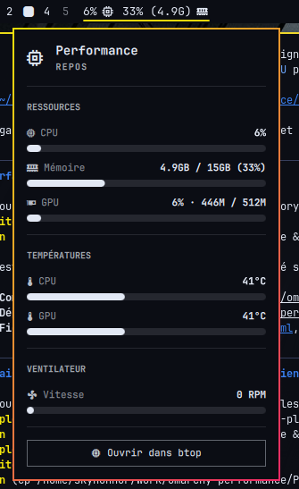

# omarchy-performance

A bar widget for [Omarchy](https://omarchy.org) that shows CPU and RAM usage at a glance and expands into a live performance panel — modelled on the built-in battery widget.

> **Credit:** Forked from [orviwan/omarchy-performance](https://github.com/orviwan/omarchy-performance) by Jon Barlow.

## Features

- **Bar button** — shows CPU% and RAM `x% (y.yG)` with chip and memory icons, colour-coded automatically:
  - CPU (by peak temperature): Normal → Amber (≥ 70 °C) → Red (≥ 90 °C)
  - RAM (by usage): Normal → Amber (≥ 80 %) → Red (≥ 92 %)
- **Click to open panel** organised into clean sections with icons and animated progress bars:
  - **Resources**: CPU %, Memory (`used / total (%)`), and **multi-GPU** usage % + VRAM (or `Sleeping` for suspended hybrid dGPUs)
  - **Temperatures**: CPU temperature and each detected GPU's temperature
  - **Fan**: Fan RPM scaled dynamically to the sensor's max RPM
  - **Open in btop** button for deep inspection
- **Automatic multi-GPU & hardware detection**:
  - Temperatures & fans via `sensors -j` (`k10temp`, `coretemp`, `dell_smm`, `acpitz`, generic `fan*_input`)
  - GPUs via `gpu-stats.sh`: **AMD** (`/sys/class/drm`), **NVIDIA** (`nvidia-smi`, without waking D3cold suspended dGPUs), and **Intel** (`/sys/class/drm`)
- **Built-in translations** (`en` and `fr`), following Omarchy's language setting live
- **IPC support** (`omarchy-shell skyhonnor.performance toggle`)
- Polls every **4 s** at rest, **2 s** while the panel is open (GPU stats polled on startup and while the panel is open)

## Screenshot



## Requirements

- [Omarchy](https://omarchy.org) 4.x (Quattro)
- `lm_sensors` — for CPU temperature and fan readings:
  ```bash
  omarchy pkg add lm_sensors
  ```
  *(Note: If your hardware does not expose sensor readings by default, see the [lm-sensors documentation](https://github.com/lm-sensors/lm-sensors/blob/master/prog/detect/sensors-detect.8#L45-L69) for device troubleshooting.)*
- `btop` — for the "Open in btop" button (included by default in Omarchy)
- `nvidia-smi` *(optional)* — for NVIDIA GPU utilization, VRAM, and temperature

## Installation

```bash
omarchy plugin add https://github.com/SkyHonnor/omarchy-performance.git --enable
```

The plugin is placed to the right of the bar by default (before the battery/power widget). Move it with:

```bash
omarchy bar move skyhonnor.performance --section left
```

## Sensor & GPU detection

The plugin automatically detects sensors and GPUs without manual configuration:

| Metric | Supported sources |
|--------|-------------------|
| CPU temperature | `k10temp` (`Tctl` / `Tdie`), `coretemp` (`Package id 0`), `dell_smm` (`CPU`), `acpitz` (`temp1`) |
| GPU metrics & temp | **AMD** (usage, VRAM & temp via `/sys/class/drm/card*/device`), **NVIDIA** (usage, VRAM & temp via `nvidia-smi -i <pci-id>` for awake devices only), **Intel** (clock speed & temp via `/sys/class/drm/card*`) — supports single and multi-GPU systems |
| Fan speed | First available `fan*_input` via `sensors -j` (with dynamic `fan*_max` scaling) |

To customise sensor priority or add another chip, edit `parseSensorsJson()` in `Panel.qml` or `gpu-stats.sh`.

## Uninstall

```bash
omarchy plugin remove skyhonnor.performance
```

## License

MIT — see [LICENSE](LICENSE). Originally created by [Jon Barlow (orviwan)](https://github.com/orviwan/omarchy-performance).
