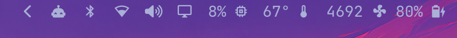

# omarchy-performance

A bar widget for [Omarchy](https://omarchy.org) that shows CPU usage at a glance and expands into a live performance panel — modelled on the built-in battery widget.

## Features

- **Bar button** — shows CPU% with a chip icon, colour-coded by temperature  
  - Normal → Amber (≥ 70 °C) → Red (≥ 90 °C)
- **Click to open panel** with:
  - CPU % hero with animated progress bar
  - Temperature reading + bar
  - Fan RPM + bar
  - Memory used / total + bar
  - **Open in btop** button for deep inspection
- Polls every **4 s** at rest, **2 s** while the panel is open
- Hot-reloads; no shell restart needed

## Screenshot



## Requirements

- [Omarchy](https://omarchy.org) 4.x (Quattro)
- `lm_sensors` — for temperature and fan readings  
  ```bash
  omarchy pkg add lm_sensors
  sudo sensors-detect --auto
  ```
- `btop` — for the "Open in btop" button  
  ```bash
  omarchy pkg add btop
  ```

> **Note:** Fan readings use the `applesmc` driver label `Right Side`, which is
> present on Apple hardware running Linux. On other machines the fan bar will
> show `—`; see [Customising sensor labels](#customising-sensor-labels) below.

## Installation

```bash
omarchy plugin add https://github.com/orviwan/omarchy-performance.git --enable
```

The plugin is placed to the right of the bar by default (before the battery/power widget). Move it with:

```bash
omarchy bar move orviwan.performance --section right
```

## Customising sensor labels

The plugin reads two fields from `sensors` output:

| Field | Default label | What it reads |
|-------|--------------|---------------|
| CPU temperature | `Package id 0:` | Intel package temperature |
| Fan speed | `Right Side` | Apple SMC right fan (applesmc) |

To adapt for other hardware, edit `Panel.qml` and change the `awk` patterns in `sensorsProc.command` to match your own `sensors` output.

Run `sensors` in a terminal to find the correct labels for your machine.

## Uninstall

```bash
omarchy plugin remove orviwan.performance
```

## License

MIT — see [LICENSE](LICENSE).
